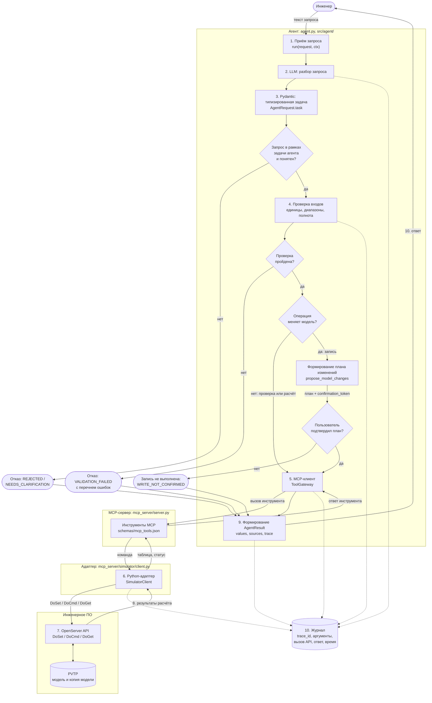
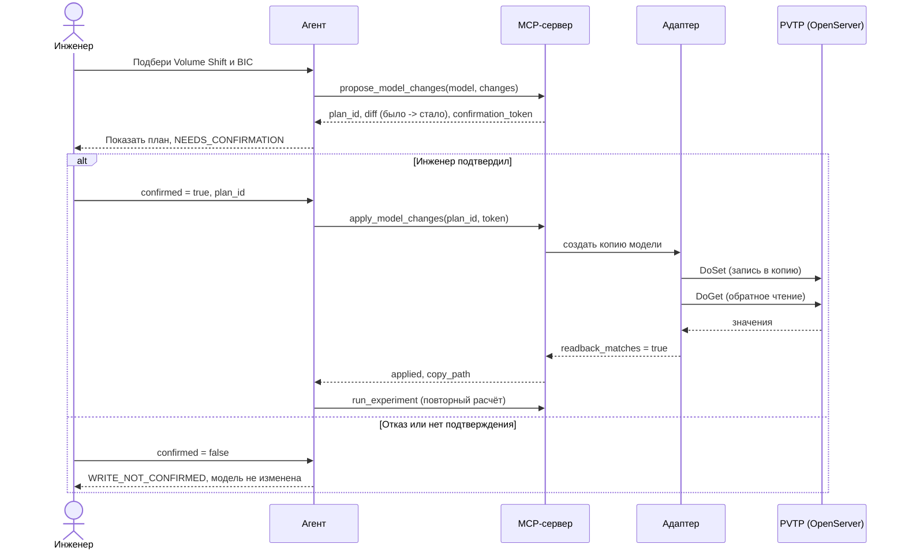

# Архитектура ИИ-агента для адаптации и проверки PVT-модели

Агент принимает запрос инженера, разбирает его языковой моделью в типизированную задачу, проверяет входы, вызывает инструменты через MCP и собирает отчёт из полученных данных. **Числа считает Petroleum Experts PVTP или проверяемый Python-код, а не LLM.**

> Пути к файлам кода указаны по шаблону курса. Часть файлов (`agent.py`, `mcp_server/server.py`, `src/agent/loop.py`) будет добавлена на этапе реализации.

Связанные файлы: [`schemas/agent_request.json`](../schemas/agent_request.json), [`schemas/agent_result.json`](../schemas/agent_result.json), [`schemas/mcp_tools.json`](../schemas/mcp_tools.json).

## 1. Принципы

1. **Агент и MCP-сервер - отдельные компоненты.** Код агента (`agent.py`, `src/agent/`) не импортирует OpenServer, COM или SDK. Вендорские зависимости живут только в `mcp_server/`.
2. **Контракт входа/выхода:** `run(request, ctx) -> AgentResult`.
3. **Запись только после подтверждения.** Изменения вносятся в копию модели; оригинал открыт только для чтения.
4. **Два независимых статуса:** `calc_status` (выполнило ли ПО операцию: `SUCCESS`, `NO_SOLUTION`, `LICENSE_BUSY`, `TIMEOUT`...) и `check_status` (результат сравнения: `OK`, `OUT_OF_TOLERANCE`, `NOT_ASSESSED`).
5. **Встроенный matching PVTP недоступен через OpenServer IPM 7.5.** Подбор параметров выполняет внешний Python-код: меняет разрешённые параметры, запускает эксперименты, читает ошибки, выбирает следующий шаг.
6. **Текст из документов - данные, а не команды.** Инструкции внутри файлов не меняют полномочия агента.

## 2. Общая блок-схема

Сплошные стрелки - передача данных, пунктир - запись в журнал.

## 3. Последовательность записи (подтверждение изменений)

Повторная отправка того же `plan_id` не добавляет изменения второй раз (идемпотентность).

## 4. Последовательность работы агента

| № | Шаг | Что происходит | Результат |
|---|-----|----------------|-----------|
| 1 | Получение запроса | `agent.py` принимает `AgentRequest` (`request_id`, `user_text`). | Присвоен `trace_id`, первая запись в журнал |
| 2 | Обработка LLM | Языковая модель разбирает текст: тип задачи, модель, эксперименты, единицы. LLM **не считает числа**. | Черновик задачи |
| 3 | Структурирование | Ответ LLM проверяется Pydantic-схемой `AgentRequest.task`. | Типизированная задача или ошибка разбора |
| 4 | Проверка входов | Единицы (°C/°F, BARa/psig), диапазоны, полнота полей, разрешённые параметры. | `valid` или список `errors` |
| 5 | Передача в MCP | MCP-клиент (`ToolGateway`) вызывает инструмент по схеме из `mcp_tools.json`. | Вызов с `trace_id` |
| 6 | MCP -> адаптер | `mcp_server/server.py` передаёт вызов в `SimulatorClient`. | Команда адаптеру |
| 7 | Адаптер -> PVTP | Адаптер выполняет `DoSet`, `DoCmd` (`PVT.PSAT/CCE/CVD/SEP[stream]`), `DoGet` (`CALC_*`). | Сырые данные ПО |
| 8 | Получение результатов | Читаются имена, единицы и значения столбцов; считаются ошибки по конфигурации метрик. | Таблица результатов |
| 9 | Ответ пользователю | Сборка `AgentResult`: `values`, `sources`, `summary`, `trace`. | Итоговый ответ |
| 10 | Журнал | На каждом шаге пишутся аргументы, вызов API, ответ, время. Ключи API не логируются. | Журнал по `trace_id` |

## 5. Некорректные запросы и отказы

| Ситуация | Где ловится | Поведение | Статус |
|----------|-------------|-----------|--------|
| Запрос вне задачи агента | шаг 3 | Вежливый отказ, расчёт не запускается | `REJECTED` |
| Нет обязательного значения | шаг 4 | Указать поле и источник, не подставлять оценку | `NEEDS_CLARIFICATION` |
| Единица или шкала неоднозначна (psig/BARa) | шаг 4 | Запросить уточнение, зависимый расчёт не выполнять | `NEEDS_CLARIFICATION` |
| Значение вне физического диапазона | шаг 4 | Ошибка с полем и допустимым диапазоном | `VALIDATION_FAILED` |
| Значение распознано со скана | шаг 4 | Ждать подтверждения до записи | `NEEDS_CONFIRMATION` |
| Запись без подтверждения | PLAN / Q4 | Показать план, не писать | `NEEDS_CONFIRMATION` / `WRITE_NOT_CONFIRMED` |
| Параметр вне разрешённого списка или границ | `propose_model_changes` | Отклонить изменение | `VALIDATION_FAILED` |
| Инструкция внутри документа | шаг 3-4 | Считать содержимым источника, полномочия не менять | ошибка `INJECTION_IGNORED` (предупреждение) |
| ПО недоступно | адаптер | Явное сообщение, не имитировать расчёт | `SOFTWARE_UNAVAILABLE` |
| Лицензия занята | адаптер | Ограниченный повтор по конфигурации, затем сообщение | `LICENSE_BUSY` |
| Таймаут | адаптер | Зафиксировать состояние, отменять только через поддерживаемый API | `TIMEOUT` |
| Решение не найдено | адаптер | Сохранить причину и настройки, чисел нет | `NO_SOLUTION` |

## 6. Описание блоков схемы

| Блок | Описание |
|------|----------|
| **Инженер** | Источник запроса на естественном языке; подтверждает план изменений. |
| **1. Приём запроса** (`agent.py`, `run(request, ctx)`) | Точка входа. Создаёт `request_id` и `trace_id`. |
| **2. LLM: разбор** | Превращает текст в черновик задачи. Не вычисляет числа и не вызывает ПО напрямую. |
| **3. Pydantic: типизированная задача** | Строгая проверка структуры по `schemas/agent_request.json`. Неверная структура - отказ до обращения к ПО. |
| **Q1 Запрос допустим?** | Отсекает запросы вне задачи (`out_of_scope`) и неполные запросы. |
| **4. Проверка входов** | Состав (PVT-01), BIC (PVT-02), единицы (PVT-03), условия экспериментов (PVT-04), записи ГКИ (GKI-01..04). Выполняется до вызова ПО. |
| **Q3 Меняет ли модель?** | Разделяет чтение/расчёт и запись. Запись идёт только через план и подтверждение. |
| **Формирование плана** | Инструмент `propose_model_changes`: список «было -> стало», проверка границ. Ничего не пишет. |
| **Q4 Подтверждение** | Пользователь явно подтверждает `plan_id`. Без `confirmation_token` `apply_model_changes` отказывает. |
| **5. MCP-клиент** (`ToolGateway`) | Вызывает инструменты по схемам, читает ответы, передаёт `trace_id`. |
| **MCP-сервер** (`mcp_server/server.py`) | Регистрирует инструменты из `mcp_tools.json`, проверяет аргументы, вызывает адаптер. |
| **6. Python-адаптер** (`SimulatorClient`) | Единственное место, где используется OpenServer. Переводит вызовы MCP в команды API, формирует статусы `LICENSE_BUSY`, `NO_SOLUTION`, `TIMEOUT`. |
| **7. OpenServer / PVTP** | `DoSet` задаёт параметры, `DoCmd` запускает расчёт, `DoGet` читает результат. Префикс управления в IPM 7.5 - `PVT`. |
| **8. Результаты** | Таблицы эксперимента: имена, единицы, значения столбцов; порядок столбцов не зашит в код. |
| **9. AgentResult** | Итоговая структура по `schemas/agent_result.json`: `values`, `sources`, `summary`, `trace`, `errors`. |
| **10. Журнал** | Запись по `trace_id`: аргументы, вызов API, ответ, время. Неудачные строки остаются с причиной. |
| **Ветки отказа** | Каждая ветка возвращает полноценный `AgentResult` с понятной причиной, а не исключение. |

## 7. Что проверяет каждый уровень

| Уровень | С чем сравнивается | Что подтверждает |
|---------|--------------------|------------------|
| Перенос данных | Манифест исходных файлов | Значения перенесены без потерь |
| Интерфейс инструмента | Схема MCP | Клиент правильно вызывает и читает инструмент |
| Расчётный адаптер | Ручной запуск того же ПО | API-команды и чтение выполнены верно |
| Инженерная модель | Независимые замеры (ГКИ, отложенные точки) | Соответствие модели наблюдениям |

Работающий MCP-вызов не подтверждает точность физической модели.

## 8. Открытые вопросы (подтверждает преподаватель)

- Адреса переменных PVTP для Volume Shift и BIC (`VOLSHIFTC`, `VOLSHIFTS`, `BINARY_INT_COMPS`) и форма Volume Shift из Excel.
- Допуски для воспроизведения API и для сравнения с замерами.
- Отложенные точки CCE/CVD и роль единственной точки Psat.
- Условия ГКИ: шкала давлений, сепарация, плотность для перевода г/м³ в объём.
